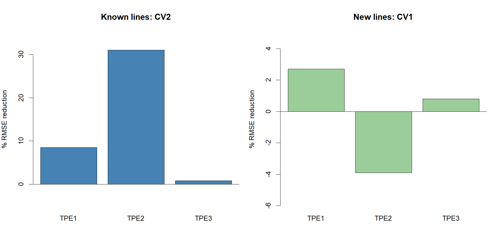

# Wheat Genomic Prediction Across Environments

This project compares genomic prediction with a site-mean baseline for wheat yield across three target populations of environments (TPE1, TPE2, and TPE3).

Two validation scenarios are evaluated:

- **CV1:** hold out all records for selected lines and predict their yield as new lines.
- **CV2:** hold out site records while the same lines remain represented at other sites.

Performance is measured with root mean squared error (RMSE); lower RMSE indicates more accurate predictions.

## Methods

The GBLUP model uses a genomic relationship matrix calculated from the marker data, with site as a fixed effect. Its predictions are compared with a baseline that predicts the training mean for each site. CV1 uses five genotype-grouped folds. CV2 uses five folds for TPE1 and TPE2, and three folds for TPE3, which has three sites. Each scenario is repeated with two random seeds.

## Preliminary results

The values below are the averages of fold-level RMSEs across the two seeded runs for each scenario.

| TPE | Validation | Site-mean RMSE | GBLUP RMSE | RMSE reduction |
|---|---|---:|---:|---:|
| TPE1 | CV1: new lines | 0.473 | 0.460 | 2.7% |
| TPE1 | CV2: known lines | 0.475 | 0.434 | 8.5% |
| TPE2 | CV1: new lines | 0.280 | 0.291 | -3.9% |
| TPE2 | CV2: known lines | 0.281 | 0.194 | 31.0% |
| TPE3 | CV1: new lines | 0.297 | 0.295 | 0.8% |
| TPE3 | CV2: known lines | 0.298 | 0.296 | 0.8% |

These results are preliminary and based on two random validation runs per scenario. The scenarios answer different prediction questions, and performance varies by TPE. In TPE2, GBLUP improved CV2 predictions but did not improve CV1 predictions.

## Reproduce the analysis

1. Obtain the four CSV files listed in [`data/README.md`](data/README.md) and place them in the local `data/` folder.
2. Open `wheat-genomic-prediction.Rproj` in RStudio.
3. If needed, install the R package with `install.packages("rrBLUP")`.
4. Open `wheat_analysis.R` and click **Source**. The script writes the summary table to `results/summary_results.csv` and the chart to `figures/prediction_comparison.png`.

## Data and citation

Phenotypic and genotypic data are from the [MultiEnv-Wheat-Genomic-Prediction repository](https://github.com/guillermogarci4/MultiEnv-Wheat-Genomic-Prediction). The repository page does not display a data license. Confirm the reuse terms before redistributing the raw CSV files; they are excluded from this project folder by `.gitignore`.

Please cite the associated paper:

García-Barrios, G., Crespo-Herrera, L. A., Cruz-Izquierdo, S., Vitale, P., Sandoval-Islas, J. S., Gerard, G. S., Aguilar-Rincón, V. H., Corona-Torres, T., Crossa, J., & Pacheco-Gil, R. A. (2024). Genomic prediction from multi-environment trials of wheat breeding. *Genes, 15*(4), 417. https://doi.org/10.3390/genes15040417
